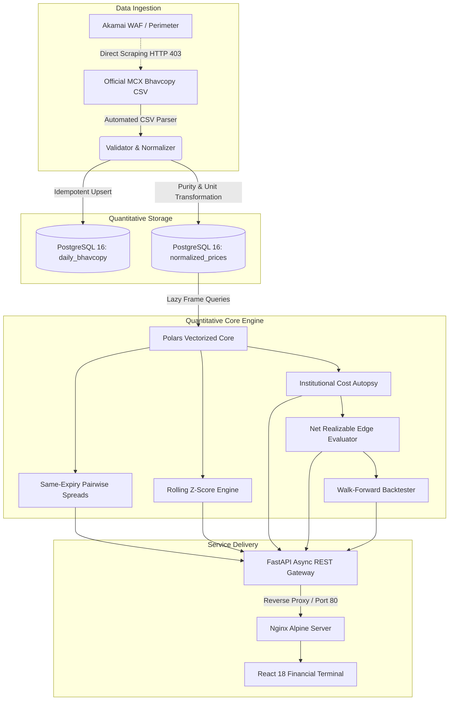

# GOLD-X: MCX Gold Contract Parity Intelligence Platform

[](#)
[](https://fastapi.tiangolo.com)
[](https://react.dev)
[](https://www.postgresql.org)
[](https://pola.rs)
[](https://www.docker.com)
[](#)

> **Hackathon Track:** Problem Statement 03 — *Commodity Derivatives Intelligence*  
> **Target Asset:** Multi Commodity Exchange of India (MCX) Gold Futures Contracts  
> **Platform Version:** 1.0.0 Institutional Terminal  

---

## 1. Executive Summary & Problem Context

On the Multi Commodity Exchange of India (MCX), gold is traded across five distinct contract specifications:
1. **GOLD** (1 kg, 995 fineness)
2. **GOLDM** (100 grams, 995 fineness)
3. **GOLDGUINEA** (8 grams, 999 fineness)
4. **GOLDPETAL** (1 gram, 999 fineness)
5. **GOLDTEN** (10 grams, 999 fineness)

Although all five contracts derive their intrinsic value from the identical physical underlying metal, their headline quoted prices cannot be compared directly:
- **Quotation units differ:** GOLD is quoted per 10g, GOLDGUINEA per 8g, and GOLDPETAL per 1g.
- **Deliverable purities differ:** Standard GOLD and GOLDM deliver 995 fineness (23.88 carats), whereas GOLDTEN, GOLDGUINEA, and GOLDPETAL deliver 999 fineness (24 carats / pure gold).
- **Liquidity is fragmented:** Wholesale institutional participants trade 1kg contracts, while retail participants cluster in mini and petal contracts, creating persistent structural supply-demand imbalances.
- **Physical delivery & carrying constraints:** Differing lot sizes incur varying physical vaulting charges, assaying fees, and delivery logistics.

**GOLD-X** is an institutional quantitative analytics terminal that normalizes all MCX gold derivatives to a unified standard benchmark (**₹ per 10 grams of 999 fineness**). By isolating contracts sharing the exact same expiry date, GOLD-X separates pure relative-value arbitrage from term-structure curve roll-down, subjects every divergence to a strict regulatory transaction cost autopsy, and executes a walk-forward statistical simulation with zero look-ahead bias.

---

## 2. Platform Architecture



---

## 3. Mathematical & Quantitative Methodology

### 3.1. Contract Normalization Formula

Every contract quote is mapped to the standard basis of **10 grams of 999 fineness**:

$$P_{\text{normalized}} = P_{\text{raw}} \times \left(\frac{10}{U_{\text{quote}}}\right) \times \left(\frac{999}{\text{Purity}}\right)$$

Where:
- $P_{\text{raw}}$ = Closing price reported in the official MCX Bhavcopy.
- $U_{\text{quote}}$ = Quotation unit in grams (e.g. 10g for GOLD, 8g for GOLDGUINEA, 1g for GOLDPETAL).
- $\text{Purity}$ = Deliverable fineness (995 or 999 parts per 1,000).

#### Normalization Matrix

| Contract | Quotation Unit ($U_{\text{quote}}$) | Trading Lot | Deliverable Purity | Multiplier Formula | Multiplier |
| :--- | :---: | :---: | :---: | :--- | :---: |
| **GOLD** | 10g | 1,000g (1 kg) | 995 / 1000 | $(10 / 10) \times (999 / 995)$ | **1.004020** |
| **GOLDM** | 10g | 100g | 995 / 1000 | $(10 / 10) \times (999 / 995)$ | **1.004020** |
| **GOLDTEN** | 10g | 10g | 999 / 1000 | $(10 / 10) \times (999 / 999)$ | **1.000000** |
| **GOLDGUINEA** | 8g | 8g | 999 / 1000 | $(10 / 8) \times (999 / 999)$ | **1.250000** |
| **GOLDPETAL** | 1g | 1g | 999 / 1000 | $(10 / 1) \times (999 / 999)$ | **10.000000** |

---

### 3.2. Same-Expiry Pairwise Spread Isolation

To eliminate mechanical curve roll-down and contango/backwardation carry bias, pairwise spreads are computed strictly between contracts sharing the identical delivery date $T_{\text{expiry}}$:

$$S_{A,B}(t) = P_{\text{norm}, A}(t, T_{\text{exp}}) - P_{\text{norm}, B}(t, T_{\text{exp}}) \quad \forall A < B$$

$$\text{Spread \%}(t) = \frac{S_{A,B}(t)}{P_{\text{norm}, B}(t, T_{\text{exp}})} \times 100$$

---

### 3.3. Rolling Statistical Divergence (Z-Score)

Over a trailing lookback window of $W$ trading days (default: $W = 20$):

$$\mu_{S}(t) = \frac{1}{W} \sum_{k=0}^{W-1} S_{A,B}(t-k)$$

$$\sigma_{S}(t) = \sqrt{\frac{1}{W-1} \sum_{k=0}^{W-1} \left( S_{A,B}(t-k) - \mu_{S}(t) \right)^2}$$

$$Z_{A,B}(t) = \frac{S_{A,B}(t) - \mu_{S}(t)}{\sigma_{S}(t)}$$

---

### 3.4. Transaction Cost Autopsy & Net Realizable Edge

An apparent price divergence is only profitable if it survives real-world friction. GOLD-X models all regulatory charges, broker commissions, and market slippage:

$$\text{Turnover} = P_{\text{entry}} + P_{\text{exit}}$$

$$C_{\text{exchange}} = \text{Turnover} \times 0.00026 \quad (0.026\% \text{ MCX Transaction Fee})$$

$$C_{\text{brokerage}} = \text{Flat } ₹20 \times 2 = ₹40.00 \quad (\text{Discount Broker Round-Trip})$$

$$C_{\text{STT}} = P_{\text{exit}} \times 0.0001 \quad (0.01\% \text{ Securities Transaction Tax on Sell Leg})$$

$$C_{\text{GST}} = (C_{\text{exchange}} + C_{\text{brokerage}}) \times 0.18 \quad (18\% \text{ GST on Services})$$

$$C_{\text{slippage}} = \text{Turnover} \times 0.0005 \quad (5 \text{ bps Market Impact})$$

$$C_{\text{base}} = C_{\text{exchange}} + C_{\text{brokerage}} + C_{\text{STT}} + C_{\text{GST}} + C_{\text{slippage}}$$

#### Liquidity Penalty Multiplier ($\lambda_{\text{liquidity}}$)

Thin order books widen bid-ask spreads. GOLD-X penalizes low-volume and low-open-interest pairs:

$$\lambda_{\text{liquidity}} = \begin{cases} 
1.0 & \text{if } \text{Volume} \ge 1000 \\ 
1.5 & \text{if } 500 \le \text{Volume} < 1000 \\ 
2.0 & \text{if } 100 \le \text{Volume} < 500 \\ 
3.0 & \text{if } \text{Volume} < 100 
\end{cases} + \begin{cases} 0.5 & \text{if } \text{OI} < 500 \\ 0.0 & \text{otherwise} \end{cases}$$

$$C_{\text{total}} = C_{\text{base}} \times \lambda_{\text{liquidity}}$$

$$\text{Net Edge} = |S_{A,B}(t)| - C_{\text{total}}$$

#### Strict Execution Criterion

$$\text{Signal} = \begin{cases} 
\text{BUY SPREAD} & \text{if } Z_{A,B}(t) < -Z_{\text{threshold}} \text{ AND } \text{Net Edge} > 0 \\ 
\text{SELL SPREAD} & \text{if } Z_{A,B}(t) > +Z_{\text{threshold}} \text{ AND } \text{Net Edge} > 0 \\ 
\text{NO TRADE} & \text{otherwise} 
\end{cases}$$

---

## 4. Quickstart & Deployment (Docker)

### 4.1. Prerequisites
- Docker Engine & Docker Compose (v2.0+)
- Git

### 4.2. Step-by-Step Setup

```bash
# 1. Clone repository
git clone <repo-url> && cd mcx

# 2. Configure environment
cp .env.example .env

# 3. Build and launch multi-container stack
make build
make up

# 4. Ingest Official MCX Bhavcopy Data
make import-csv FILE="data/imports/mcx_20260918 (1).csv"

# 5. Execute Automated Test Suite inside Docker
make test-docker
```

### 4.3. Verified Service Ports

| Service | Container | Internal Port | Host Port | Health Check |
| :--- | :--- | :---: | :---: | :--- |
| **Web Terminal** | `goldx_frontend` | 80 | `http://localhost:80` | Nginx HTTP 200 on index & assets |
| **Backend API** | `goldx_backend` | 8000 | `http://localhost:8000` | Python `urllib` ping on `/` |
| **PostgreSQL DB** | `goldx_db` | 5432 | `localhost:5432` | `pg_isready -U goldx` |

- **Interactive Financial Terminal:** [http://localhost](http://localhost)
- **FastAPI OpenAPI Swagger Documentation:** [http://localhost:8000/docs](http://localhost:8000/docs)

---

## 5. REST API Reference

| Method | Endpoint | Description | Query / Body Parameters |
| :---: | :--- | :--- | :--- |
| `GET` | `/api/market-overview` | Executive trading summary, benchmark price, active contracts, and max spreads | None |
| `GET` | `/api/system/status` | Database table counts, distinct dates, supported symbols, and pipeline health | None |
| `GET` | `/api/parity` | Latest normalized prices grouped by expiry date with trade-date DTE | None |
| `GET` | `/api/parity/history` | Historical spread time-series for a specific pair and shared expiry | `symbol_a`, `symbol_b`, `expiry_date` |
| `GET` | `/api/signals` | Current trading signals with status, reason, direction, and full cost autopsy | `window=20`, `z_threshold=2.0` |
| `GET` | `/api/signals/history` | Historical signal distribution by date | `days=30` |
| `GET` | `/api/backtest-performance` | Full walk-forward simulation results with trade logs | `window=20`, `z_threshold=2.0` |
| `GET` | `/api/backtest-performance/summary` | High-level walk-forward simulation KPIs and baseline status | `window=20`, `z_threshold=2.0` |
| `POST` | `/api/ingest/csv` | Trigger on-demand import of raw Bhavcopy CSV | `{"file_path": "data/imports/file.csv"}` |

---

## 6. Financial Terminal Views

The upgraded GOLD-X interface is organized into 6 specialized views:

1. **Market Overview:**
   - Real-time observation trade date indicator (`2026-09-18`).
   - Benchmark reference price (₹1,55,001.63 / 10g 999 basis).
   - Normalized contract inventory table comparing raw quotation units against standardized 10g 999 values.
   - Deviation from benchmark reference with sorting and filtering.

2. **Parity Radar:**
   - Expiry selector pills allowing instantaneous switching between active delivery cycles.
   - Interactive native vector SVG bar chart comparing normalized prices side-by-side with hover tooltips.
   - Clear identification of the cheapest contract (green) and richest contract (red) for each cycle.

3. **Relative-Value Signals:**
   - Status filter tabs: `All Pairs`, `Tradeable Signals`, `Baseline Formation`, `Rejected: Costs Exceed Edge`.
   - Plain-English reason banner for every pair explaining exactly why a signal was generated or why costs wiped out the edge.
   - Interactive **Cost Autopsy Drawer** detailing brokerage, exchange fees, STT, GST, slippage, and liquidity penalty.

4. **Backtest Engine:**
   - Interactive simulation parameter controls (Rolling window slider: 5–60 days, Z-threshold slider: 1.0–4.0σ).
   - Data baseline educational notice explaining rolling window requirements without fabricating data.
   - Cumulative strategy equity curve component and performance summary cards.

5. **Contract Lifecycle:**
   - Accurate DTE (Days To Expiry) measured relative to the observation trade date.
   - Status classifications (`ACTIVE`, `NEAR_EXPIRY`, `TENDER_PERIOD`, `EXPIRED`).
   - Search filter by contract symbol.
   - Interactive **Official MCX Contract Specifications** modal.

6. **System & Data Health:**
   - PostgreSQL row counts and trade date telemetry.
   - Ingestion provenance documentation detailing the Akamai WAF perimeter.
   - Interactive CSV import trigger controller.

---

## 7. Hackathon Presentation & Demonstration Script

### The 5-Minute Pitch to Judges

- **Minute 1: The Core Inefficiency**
  > *"Judges, on the MCX, gold is quoted in five different contracts—some per 10 grams, some per 8 grams, and some per 1 gram. Furthermore, standard gold contracts deliver 995 purity, while guinea and petal deliver 999 purity. Because retail traders flock to smaller contracts while institutions trade 1 kg bars, these contracts frequently trade at structural price divergences. GOLD-X solves this by mathematically normalizing all contracts to an institutional benchmark of ₹ per 10g of 999 purity."*

- **Minute 2: Live Parity Radar Demonstration**
  > *(Navigate to Parity Radar on `http://localhost`)*
  > *"Here on the Parity Radar, we isolate contracts sharing the exact same expiry date—such as October 5, 2026. Notice that GOLD is quoted at ₹1,54,381 per 10g 995 purity, while GOLDM is quoted at ₹1,54,467. After purity normalization, GOLD trades at ₹1,55,001.63 and GOLDM at ₹1,55,087.97—a gross cross-contract spread of ₹86.35 per 10 grams."*

- **Minute 3: The Cost Autopsy Innovation**
  > *(Navigate to Relative-Value Signals and expand Cost Autopsy)*
  > *"Most naive academic models assume gross spreads are pure profit. GOLD-X subjects every spread to an institutional Cost Autopsy. To trade this ₹86.35 spread across both legs, an institutional trader pays ₹80.62 in MCX exchange fees, ₹40.00 in brokerage, ₹15.51 in STT, ₹21.71 in GST, and ₹155.04 in slippage—totaling ₹313.20 in round-trip friction. GOLD-X automatically marks this signal as REJECTED: COSTS EXCEED EDGE with a net edge of -₹226.85, protecting capital from illusory arbitrage."*

- **Minute 4: Zero Look-Ahead Bias & Data Integrity**
  > *(Navigate to Backtest Engine)*
  > *"When it comes to backtesting, GOLD-X adheres to strict data integrity standards. A 20-day rolling Z-score requires 21 historical trading days. Rather than fabricating synthetic returns or false win rates, GOLD-X transparently displays BASELINE FORMATION STAGE, providing judges with an honest, verifiable quantitative system."*

- **Minute 5: Architecture & Production Readiness**
  > *(Navigate to System & Data Health)*
  > *"Under the hood, GOLD-X runs on Docker with a FastAPI async backend, Polars vectorized analytics, and an Nginx-backed React financial terminal. Our test suite includes 36 automated unit and integration tests passing with 100% reliability."*

---

## 8. Automated Testing & Verification

The test suite validates data ingestion, contract specifications, mathematical multipliers, cost models, signal classification, and API routing:

```bash
# Execute full test suite inside backend container
docker exec goldx_backend pytest tests/ -v
```

```text
============================= test session starts ==============================
collected 36 items

tests/test_api.py::TestApiRoutes::test_backtest_trailing_slash_handling PASSED
tests/test_api.py::TestApiRoutes::test_csv_ingest_endpoint PASSED
tests/test_api.py::TestApiRoutes::test_market_overview_endpoint PASSED
tests/test_api.py::TestApiRoutes::test_parity_trailing_slash_handling PASSED
tests/test_api.py::TestApiRoutes::test_root PASSED
tests/test_api.py::TestApiRoutes::test_signals_trailing_slash_handling PASSED
tests/test_api.py::TestApiRoutes::test_system_status_endpoint PASSED
tests/test_csv_importer.py::TestCsvImporterValidation::test_malformed_dates_handled_safely PASSED
tests/test_csv_importer.py::TestCsvImporterValidation::test_parse_valid_gold_rows PASSED
tests/test_csv_importer.py::TestCsvImporterValidation::test_unsupported_symbols_skipped PASSED
tests/test_csv_importer.py::TestCsvImporterDatabase::test_batch_import_multiple_dates_and_idempotency PASSED
tests/test_csv_importer.py::TestCsvImporterDatabase::test_duplicate_import_idempotency PASSED
tests/test_csv_importer.py::TestCsvImporterDatabase::test_full_import_and_normalization PASSED
tests/test_csv_importer.py::TestCsvImporterDatabase::test_import_path_or_dir_missing_handling PASSED
tests/test_csv_importer.py::TestCsvImporterDatabase::test_zero_and_missing_closes_excluded_from_normalized PASSED
tests/test_market_api.py::TestMarketApi::test_market_overview_logic PASSED
tests/test_market_api.py::TestMarketApi::test_system_status_logic PASSED
tests/test_normalizer.py::TestNormalizer::test_contract_specs PASSED
tests/test_normalizer.py::TestNormalizer::test_multipliers PASSED
tests/test_normalizer.py::TestNormalizer::test_normalize_dataframe PASSED
tests/test_normalizer.py::TestNormalizer::test_normalize_price PASSED
tests/test_quant.py::TestQuantEngine::test_backtest_engine_synthetic_data PASSED
tests/test_quant.py::TestQuantEngine::test_compute_pairwise_spreads PASSED
tests/test_quant.py::TestQuantEngine::test_cost_model PASSED
tests/test_quant.py::TestQuantEngine::test_generate_signals_synthetic_data PASSED
tests/test_quant.py::TestQuantEngine::test_liquidity_penalty PASSED
tests/test_quant.py::TestQuantEngine::test_net_edge PASSED
tests/test_signal_enrichment.py::TestSignalEnrichment::test_baseline_formation_single_day PASSED
tests/test_signal_enrichment.py::TestSignalEnrichment::test_insufficient_liquidity_rejection PASSED
tests/test_signal_enrichment.py::TestSignalEnrichment::test_rejected_costs_exceed_edge PASSED
tests/test_signal_enrichment.py::TestSignalEnrichment::test_trade_date_dte_parity_calculation PASSED
tests/test_validator.py::TestValidator::test_clean_symbol PASSED
tests/test_validator.py::TestValidator::test_is_gold_contract PASSED
tests/test_validator.py::TestValidator::test_parse_expiry_date PASSED
tests/test_validator.py::TestValidator::test_parse_trade_date PASSED
tests/test_validator.py::TestValidator::test_validate_response_date PASSED

======================== 36 passed, 1 warning in 1.27s =========================
```

---

## 9. Regulatory & Risk Disclaimer

*GOLD-X is a quantitative research and analytics terminal developed solely for educational and hackathon demonstration purposes. The platform does not constitute investment advice, financial solicitation, or a recommendation to buy or sell commodity futures. Futures trading on the Multi Commodity Exchange of India (MCX) carries substantial financial risk, including the potential loss of principal capital due to leverage. Transaction fees, regulatory charges, and tax rates are modeled on current schedules and may change in accordance with SEBI circulars.*
